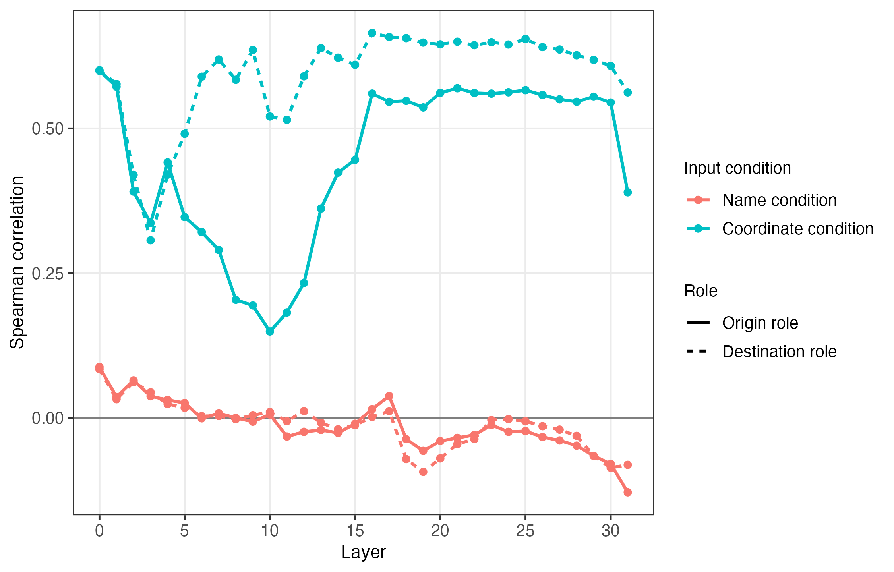

:::: {.profile-header}
::: {.profile-main}

Human mobility and spatial data science

# Woohyung Kim

I study urban human mobility: where people travel, how flows vary across space, and what mobility models miss.

My work uses spatial interaction models and machine learning to examine geographic variation in prediction, bias in mobility data, and accessibility. I am also interested in how geographic knowledge can inform emerging AI systems.

::: {.text-links}
[Research](research.qmd)
[Curriculum vitae](files/Woohyung_Kim_CV.pdf)
[GitHub](https://github.com/geowhk)
:::
:::

::: {.profile-meta}

Current profile

Education
M.A. in Geography Education  
Seoul National University, 2026

Location
Seoul, South Korea

Email
[whk3423@gmail.com](mailto:whk3423@gmail.com)
:::
::::

:::::: {.content-shell}
## Research focus

::::: {.research-list}
:::: {.research-item}
::: {.item-number}
01
:::

::: {.item-copy}
### Urban mobility

OD flows, destination choice, activity patterns, and travel behavior.
:::
::::

:::: {.research-item}
::: {.item-number}
02
:::

::: {.item-copy}
### Model geography

Spatial dependence, geographic context, and uneven model error across places.
:::
::::

:::: {.research-item}
::: {.item-number}
03
:::

::: {.item-copy}
### Data and accessibility

Representation bias in mobility data and its consequences for accessibility analysis.
:::
::::

:::: {.research-item}
::: {.item-number}
04
:::

::: {.item-copy}
### Geographic representations

Testing whether learned representations encode spatial structure that remains useful in downstream geographic analysis.
:::
::::
:::::

## Recent work

:::: {.research-plate}
::: {.plate-copy}

Master's thesis, 2026

### Evaluating LLM representations for spatial interaction

My master's thesis tested whether frozen Llama 3 representations of Seoul place names and centroid coordinates could reproduce hourly origin-destination flows.

Coordinate prompts encoded geographic distance more clearly, but that internal signal did not yield better flow estimates. Gravity-based baselines remained stronger.

[Read the project summary](research.qmd#masters-thesis)  
[View the reproducibility archive](https://github.com/geowhk/llm-human-mobility)
:::

::: {.plate-figure}
{fig-alt="Line chart showing much stronger geographic alignment for coordinate-based representations than name-based representations across LLM layers."}
:::
::::

## Presentation

::: {.presentation-record}
18 March 2026

**Probing the Geographic Reasoning of Large Language Models for Human Mobility Analysis**  
Oral presentation, AAG Annual Meeting, GeoAI and Deep Learning Symposium, San Francisco
:::

::: {.contact-line}
[Email](mailto:whk3423@gmail.com) · [CV](files/Woohyung_Kim_CV.pdf) · [GitHub](https://github.com/geowhk)
:::
::::::
