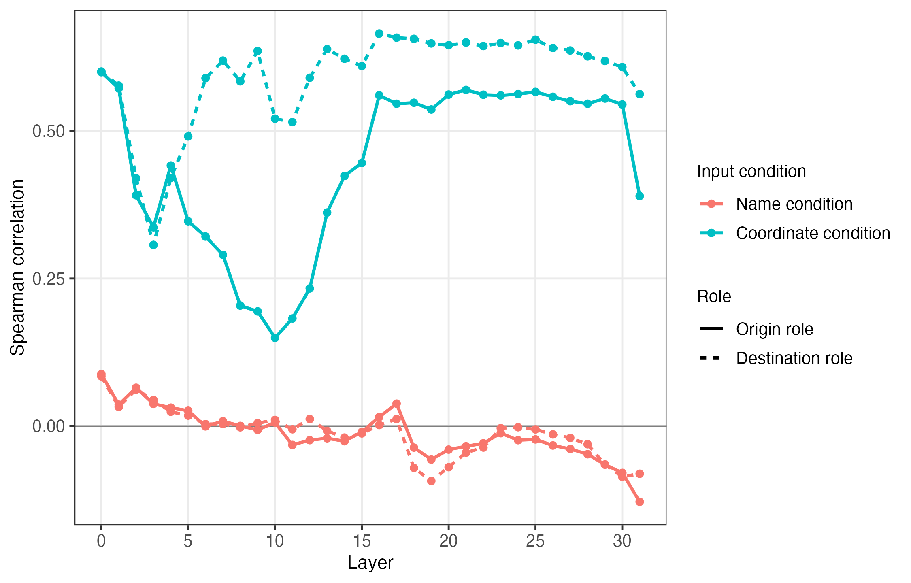

I focus on urban human mobility. The questions that interest me concern origin-destination flows, destination choice, spatially uneven model error, and the limits of passively collected movement data.

## Current questions

### How should geographic context enter mobility models?

I am interested in models that account for spatial interaction and dependence instead of treating observations as independent or space as homogeneous. This includes research on OD flows, trajectories, activity patterns, destination choice, and travel behavior.

### Where do models transfer, and where do they fail?

Aggregate performance can hide large differences across neighborhoods, cities, populations, and data sources. I want to study this variation directly, both as a modeling problem and as a question about which geographic relationships transfer.

### Whose mobility is poorly represented?

Mobility datasets differ in coverage and measurement quality. I am interested in how those differences affect accessibility estimates and conclusions about vulnerable populations.

### What geographic information do learned representations retain?

My recent work examined this question in a large language model. I remain interested in geographic representation learning and in foundation, generative, or agentic systems when they bear on mobility questions and can be evaluated against spatial evidence.

## Master's thesis {#masters-thesis}

**Evaluating the Capacity of Large Language Model Representations to Capture Spatial Interaction Structure: A Case Study Using Seoul Living Mobility Data**  
M.A. thesis, Seoul National University, August 2026  
Advisor: Prof. Sang-Il Lee

The thesis tested whether representations extracted from a frozen Llama 3 model could capture and reproduce urban spatial interaction. I used hourly weekday OD flows within Seoul and compared prompts containing place names with prompts containing centroid coordinates.

The analysis asked two separate questions. First, could a linear readout reproduce held-out flow magnitudes and spatial patterns? Second, did the representations encode distance, origin and destination roles, flow magnitude, or geographic distance structure across model layers?

Coordinate prompts showed much stronger internal signals for distance and geographic alignment. Neither prompt condition, however, consistently matched structural baselines such as a gravity model in flow estimation. This gap between detectable information inside a model and useful information for geographic prediction now guides my work on representation evaluation.

{fig-alt="Line chart showing much stronger geographic alignment for coordinate-based representations than name-based representations across LLM layers."}

[Code, configurations, aggregate results, and reproducibility notes](https://github.com/geowhk/llm-human-mobility)

## Conference presentation

**Probing the Geographic Reasoning of Large Language Models for Human Mobility Analysis**  
Oral presentation at the 2026 Annual Meeting of the American Association of Geographers, San Francisco, California, 18 March 2026.

Session: *GeoAI and Deep Learning Symposium: AI and Machine Learning Application in Human Mobility Analysis*
